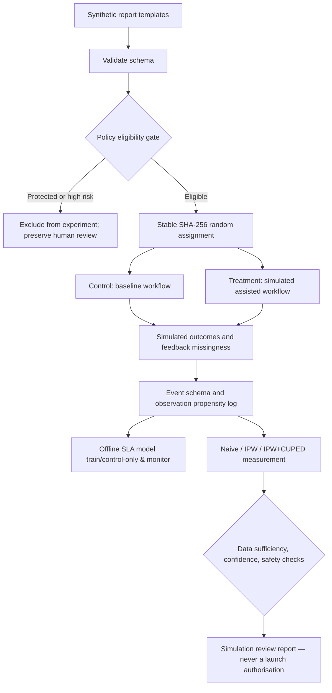

# RiskOps Experimentation Lab — Architecture and Design Review

## Decision and ownership

Question: *Does an assisted-routing policy increase SLA success for eligible lower-risk reports without weakening protected review?* This is a **simulated study**, not an evaluation of a deployed policy. The platform demonstrates experiment design and maintainability, not experience managing an engineering team.

## Statistical estimand

Intent-to-treat **risk difference**, treatment minus control, in probability of SLA success among eligible reports. Primary outcome is binary. Assignment is made before outcomes, and stable hashing ensures reproducible 50/50 treatment allocation for each experiment unit. Never assign by a feature correlated with outcomes.

Missing feedback is MAR conditional on explicitly logged covariates by construction in the synthetic simulation. We use the *known synthetic propensity* `p_i=P(feedback observed | measured features, arm)` and the stabilised Hájek estimate `sum(observed_i * y_i / p_i)/sum(observed_i / p_i)` per arm. This is useful as a test bed but real estimates must fit and validate a propensity model. Logging selection probabilities alone never proves MAR; MNAR requires sensitivity analysis.

CUPED uses the pre-treatment `baseline_score` and pooled regression coefficient `theta = cov_w(X,Y) / var_w(X)`; the transformed response `Y - theta * (X - mean(X in eligible population))` aims to reduce variance. Confidence intervals are first-order influence function based and are **not** sequentially valid. No claims of success are warranted from repeatedly inspecting interim results.

## Safety and governance requirements

1. **Eligibility gate:** no high/critical severity, sensitive category, low-confidence case, or case already requiring mandatory human review can enter the treatment arm. The protected category list is inherited from the parent project.
2. **Preserve human oversight:** assignment never changes the existing `human_review_required` field.
3. **Fail closed:** review cannot pass when any protected case was exposed, a review invariant failed, or observed sample size is inadequate.
4. **No real launch authorisation:** `production_launch_authorised=false` is hard-coded in the result. Even `simulation_pass` means *only* that predeclared checks passed on artificial data.
5. **No personal information:** the model input is the parent repository's entirely synthetic examples. Do not ingest operational incident text, personal data or client matter details without permission, privacy assessment and security review.

## Architecture choices and trade-offs

| Choice | Rationale | Production gap |
|---|---|---|
| SHA-256 assignment | deterministic, reproducible, independent of features | persist experiment config + exposure audit in event store |
| Generated data from existing synthetic repo CSV | integrates with real parent project, no PII | streaming ingest, immutable schema registry and data validation |
| pandas/numpy experiment core | inspectable implementation, fast feedback | distributed batch processing, storage and feature contracts |
| FastAPI stateless `/simulate` | demo of serving and request validation | authentication, rate limits, privacy controls, tracing, caching |
| CI + tests + container build recipe | reproducibility and integration gates | deployment approvals, image scanning, IaC and rollbacks |
| IPW + CUPED | explicit missingness adjustment and sensitivity | verified propensity overlap; DR estimators; cluster robust SEs |

## Threats to validity

- Outcome generation inserts an effect parameter. It does not discover a causal effect in real data.
- The synthetic template CSV may not represent traffic or the severity distribution in a real system.
- Logged observation probabilities are oracle values. Estimating propensities in actual data introduces model error.
- No guaranteed causal identification under unobserved confounding of feedback missingness.
- Normal confidence intervals are unsuitable for peeking or repeated experiments; use preregistered fixed horizons or e-values/always-valid tests.
- A simulated zero safety violation is an invariant, **not** a safety assurance about real deployments.

## Next engineering milestones (for genuine ML infrastructure depth)

1. Refactor event model into a documented versioned schema, and persist exposure/outcome audit trails in DuckDB/PostgreSQL.
2. Add an independent propensity estimation and calibration pipeline, group-aware validation, weight diagnostics/overlap tests, sensitivity analysis, and a doubly robust AIPW estimator.
3. Build an ML candidate triage model with tracked runs, reproducible training, model registry, drift alerts and offline eval gates.
4. Add experiment design: power calculator, multiple testing correction, proper sequential confidence and noninferiority safety analysis.
5. Deploy to a managed staging environment with IaC, auth, tracing, privacy redaction and rollback demonstrations.

## Suggested technical leadership artifacts

Write an ADR for treatment assignment and one for feedback missingness. Request external code review, respond to critique through a PR, record load test results and design changes. Those are credible *technical ownership* signals; a solo portfolio project is not evidence of personnel leadership.

## ML lifecycle prototype

`modeling.py` trains a scikit-learn SLA-success baseline from **observed control-arm** events only (to prevent treatment leakage); uses inverse-observation-propensity sample weights, an isolated stratified holdout, Brier score/AUC, a SHA-256 artifact digest and model manifest. The simple model is deliberately not deployed for safety routing. `monitoring.py` computes categorical PSI as an example of an operational distribution-shift alert; real production would also require label delay handling, model calibration/drift assessment, performance by cohort and action policies. Only load locally trusted `joblib` artifacts.

## October 2026 hardening update

The initial experiment wrote `human_review_preserved=True` without checking any selected routing action. This is now replaced by explicit `route_action` values for every synthetic event, chosen independently in `policy.py`. `audit_routing()` recalculates expected policy eligibility and flags any protected route exposure, bypass of a source-required review, invalid arm or mismatched action. A simulated decision fails even if its former summary status fields have been forged to indicate safety.

The HTML report now separates the canonical Python-estimated experiment (top) from a deterministic **browser-only exploratory simulator** (bottom). It is not a live dashboard, and browser what-if results are not guaranteed to equal canonical Python estimates because the small in-browser generator uses simplified assumptions. CI estimates in both engines remain approximate and fixed-horizon.

`power.py` supplies a fixed-horizon independent Bernoulli sample-size approximation; `weight_diagnostics()` gives observed sample size, effective sample size and propensity ranges for interpretation of oracle IPW weights. Neither constitutes proof of missing-at-random feedback, production safety, or valid sequential inference.
